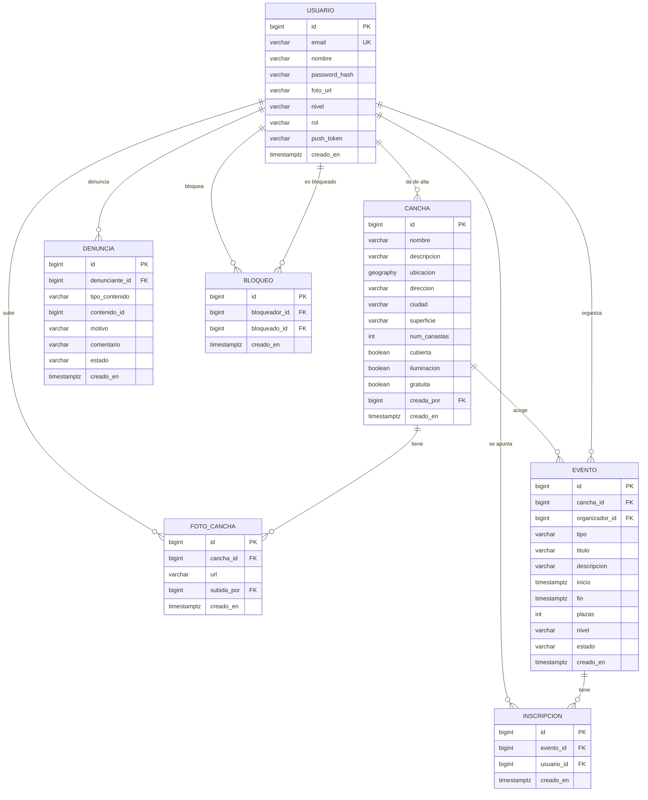

# Base de datos

PostgreSQL 17 con la extensión **PostGIS**, que añade tipos y funciones geográficas (puntos en el mapa y distancias en metros).

Las tablas se crean con **Flyway** a partir de scripts SQL versionados en
[`pachanga-api/src/main/resources/db/migration`](../pachanga-api/src/main/resources/db/migration).
Hibernate no crea ni modifica tablas (`ddl-auto=validate`): solo comprueba al arrancar que las clases Java coinciden con ellas.

## Diagrama entidad-relación



## Tablas

| Tabla | Qué guarda |
|---|---|
| `usuario` | Personas registradas. El email es único y se guarda en minúsculas. La contraseña se guarda como hash (BCrypt), nunca en claro. |
| `cancha` | Pistas de baloncesto con su ubicación (`geography(Point, 4326)`), ciudad y características (suelo, canastas, cubierta, luz, gratuita). |
| `foto_cancha` | URLs de las fotos de cada cancha. Las imágenes se guardan en Supabase Storage. |
| `evento` | Pachangas y entrenos: cancha, organizador, fecha y hora de inicio y fin, plazas, nivel y si está activo o cancelado. |
| `inscripcion` | Qué usuarios se han apuntado a qué evento (relación N:M entre `usuario` y `evento`). |
| `denuncia` | Avisos de contenido inapropiado sobre una cancha, foto, evento o usuario. |
| `bloqueo` | Usuarios que un usuario ha bloqueado. |

## Decisiones de diseño

- **Ubicación con PostGIS (`geography`)**: permite preguntar "canchas a menos de X metros" directamente en la base de datos con `ST_DWithin`, con distancias reales en metros. Un índice espacial **GIST** hace que la consulta sea rápida aunque haya miles de canchas.
- **Evitar canchas duplicadas**: antes de crear una cancha, el backend busca las que haya a menos de ~50 m y la app pregunta "¿es alguna de estas?".
- **Fechas en UTC (`timestamptz`)**: se guardan en hora universal y la app las muestra en la hora del móvil. Así funciona igual en la península que en Canarias.
- **Valores fijos con `CHECK`** (tipo de evento, nivel, estado...): la base de datos rechaza valores no válidos aunque el código tuviera un fallo. En Java son `enum`.
- **Restricciones `UNIQUE`**: nadie puede apuntarse dos veces al mismo evento, bloquear dos veces a la misma persona ni denunciar dos veces lo mismo.
- **Borrados (`ON DELETE`)**:
  - Si se borra una cancha, se borran sus fotos y eventos (`CASCADE`).
  - Si se borra un usuario, sus canchas y fotos se quedan, sin autor (`SET NULL`), porque son útiles para todos.
  - Si se borra un usuario, sus eventos, inscripciones, denuncias y bloqueos sí se borran.
- **Denuncias "polimórficas"**: `tipo_contenido` + `contenido_id` indican qué se denuncia. No hay clave foránea porque puede apuntar a tablas distintas.
- **Plazas**: el número de plazas incluye al organizador. Las reglas (no superar las plazas, no apuntarse a un evento pasado o cancelado...) van en el backend.

## Cómo cambiar el esquema

**No se edita nunca un script ya aplicado.** Para cualquier cambio se crea uno nuevo con el siguiente número:

```
V1__esquema_inicial.sql
V2__anadir_telefono_usuario.sql   ← ejemplo
```

Flyway apunta en la tabla `flyway_schema_history` qué scripts ha ejecutado y, al arrancar, solo ejecuta los nuevos.
